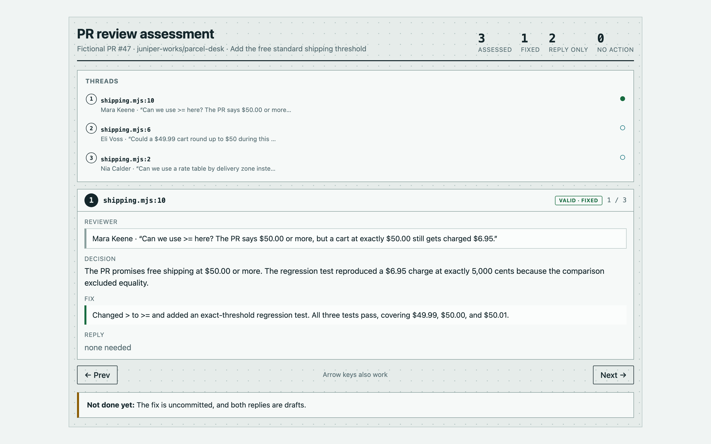
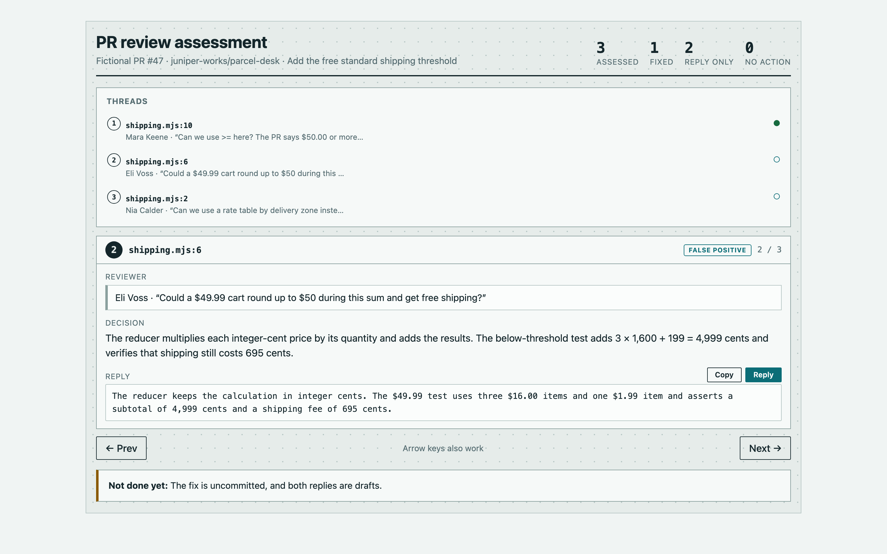
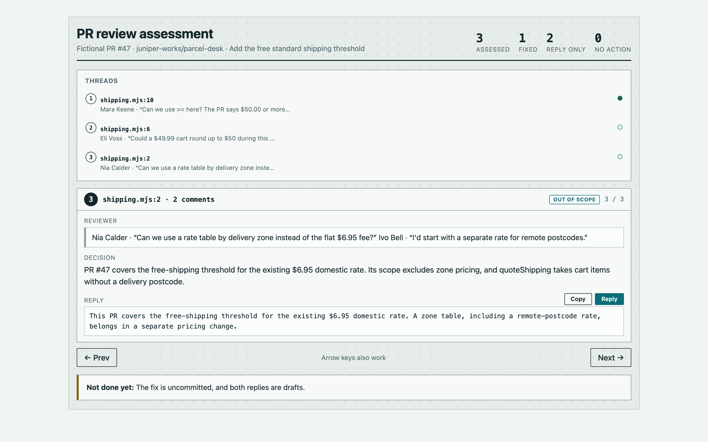

# Assess PR Review Comments

Use this skill to evaluate a pasted review comment or the unresolved threads on a pull request. It checks each thread against the current code, the PR’s stated scope, and relevant tests. It fixes valid issues and drafts evidence-based replies for false positives, out-of-scope requests, and fixes that differ from the reviewer’s suggestion.

[Read the skill instructions](SKILL.md)

## Demo

In this fictional PR, orders at exactly $50.00 were still charged for shipping. The assessment shows the inclusive threshold fix and its regression test. The other threads show an editable reply backed by the $49.99 test and a reply to an out-of-scope request for zone pricing.

