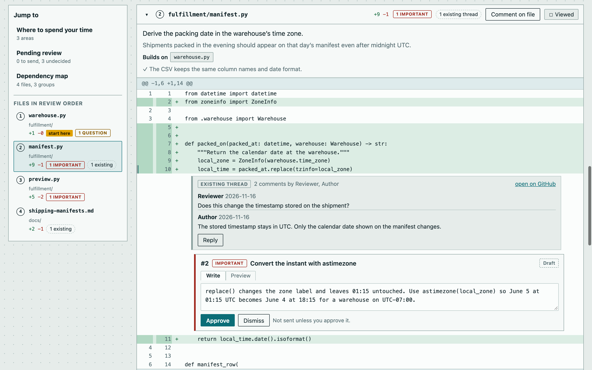
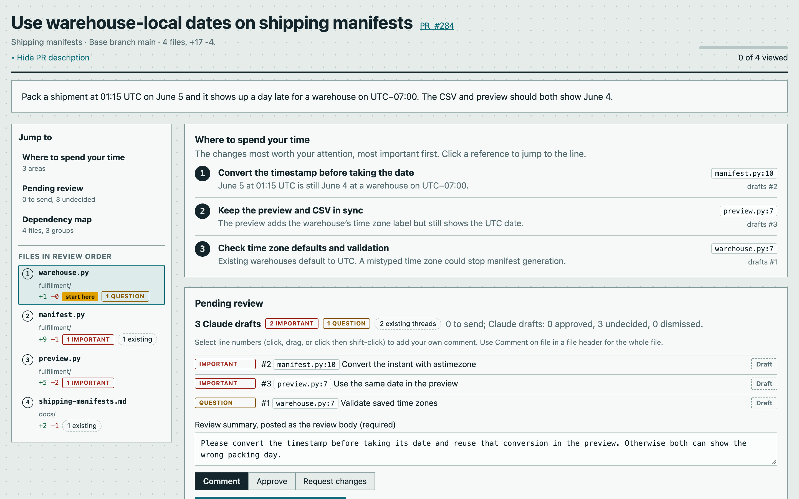
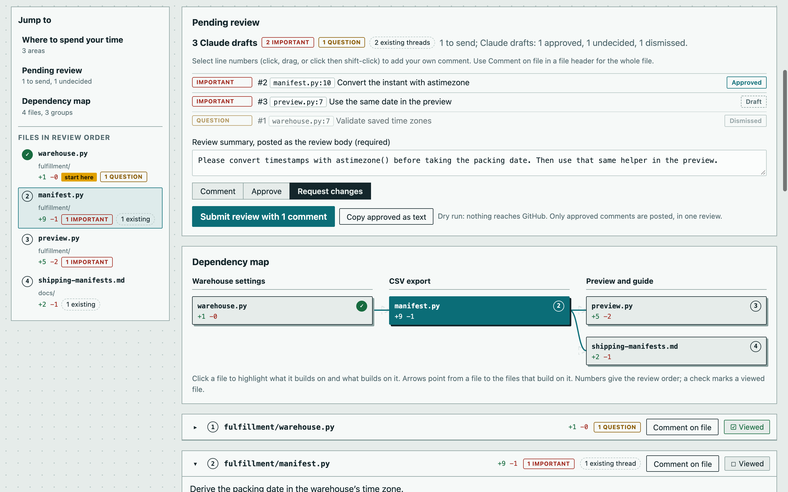

# Change Review Walkthrough

Review a pull request or uncommitted changes in one browser page. The walkthrough suggests a reading order and shows the diff, the changes worth focusing on, draft findings, and existing review threads. You can edit draft comments or add your own. [Skill instructions](SKILL.md)

## Demo

The screenshots show a fictional PR that adds retries for transient export failures. This view shows the diff alongside an existing thread and an editable draft review comment.

## Requirements and review actions

The walkthrough uses Git, Python 3, Node.js, and a browser. GitHub PRs also require an authenticated GitHub CLI (`gh`).

- **PR review.** Submit posts the review you approve. For a rehearsal, run the page in dry-run mode.
- **Local review.** Submit can return questions or requested changes to the agent. Approving the changes authorizes the agent to commit, push, and open a PR.
